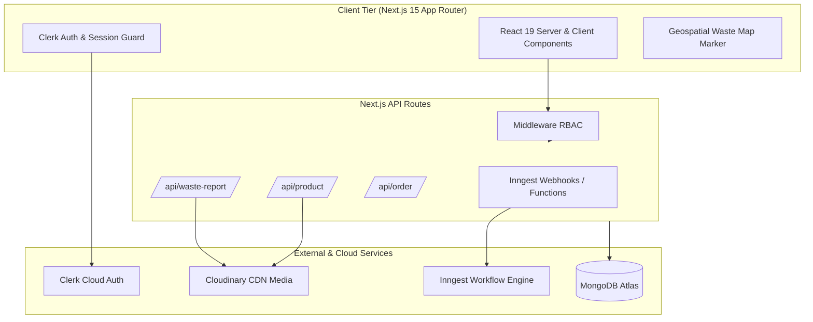

# 🌱 Eco-Hive — Sustainable E-Commerce & Community Waste Reporting Platform

[](https://nextjs.org/)
[](https://react.dev/)
[](https://www.typescriptlang.org/)
[](https://www.mongodb.com/)
[](https://clerk.com/)
[](https://tailwindcss.com/)
[](LICENSE)

**Eco-Hive** is an end-to-end full-stack web platform bridging sustainable commerce with civic environmental action. It combines an eco-friendly marketplace with an interactive geospatial waste-reporting system, empowering communities to shop responsibly while reporting and tracking local environmental waste spots.

---

## 🌟 Key Highlights & Features

### 🛍️ 1. Eco-Friendly E-Commerce Storefront
- **Product Discovery**: Filter, search, and browse sustainable eco-friendly products.
- **Cart & Order Flow**: Full persistent cart management, address selection, and automated order processing.
- **Order Tracking**: Real-time status tracking for customer purchases.

### 🗺️ 2. Civic Waste Reporting & Geospatial Tracking
- **Interactive Map**: Geolocation-based waste reporting with leaflet/map markers.
- **Photo Uploads**: Direct image capture and cloud uploads powered by Cloudinary.
- **Status Workflow**: Waste reports transition through Pending, In Review, and Resolved lifecycle stages.

### 🛡️ 3. Role-Based Access Control (RBAC) via Clerk
- **Customer**: Shop, track orders, and report community waste.
- **Seller**: Product catalog management, inventory addition, and order fulfillment.
- **Admin**: Platform-wide metrics, sales analytics, user overview, waste report approvals, and CSV export.

### ⚡ 4. Event-Driven Background Workflows (Inngest)
- Asynchronous synchronization of Clerk user accounts to MongoDB.
- Resilient background task handling without server timeouts.

---

## 🏗️ System Architecture



---

## 📁 Repository Structure

```plaintext
Eco-Hive-eco-friendly-platform/
├── app/                        # Next.js 15 App Router
│   ├── about-us/               # Platform mission & story
│   ├── add-address/            # User shipping address management
│   ├── admin/                  # Admin portal (dashboard, orders, users, waste reports)
│   ├── all-products/           # Product catalog browsing & filtering
│   ├── api/                    # Serverless API routes (cart, orders, inngest, waste)
│   ├── cart/                   # Shopping cart & checkout flow
│   ├── my-orders/              # Customer order history & tracking
│   ├── product/[id]/           # Product detail view with dynamic routing
│   ├── report-waste/           # Citizen waste reporting interface
│   └── seller/                 # Seller portal (product creation, inventory)
├── components/                 # Reusable React components
│   ├── admin/                  # Metrics, charts, order/report tables
│   ├── map/                    # Interactive geospatial map viewer
│   ├── seller/                 # Seller navigation and forms
│   └── *.jsx                   # Navbar, Footer, ProductCard, WasteReportForm
├── config/                     # Database (Mongoose) & Inngest client configs
├── context/                    # React Context for global client state (Cart, User)
├── lib/                        # Authorization guards & Cloudinary helpers
├── models/                     # Mongoose schemas (User, Product, Order, WasteReport)
├── public/                     # Static icons, banners, and logos
└── scripts/                    # Admin CLI setup scripts (e.g., Clerk role provisioning)
```

---

## 🚀 Quickstart & Local Setup

### Prerequisites
- **Node.js** (v18.18+ or v20+ recommended)
- **npm** / **yarn** / **pnpm**
- A **MongoDB Atlas** database cluster
- Free accounts for **Clerk**, **Cloudinary**, and **Inngest**

### 1. Clone the repository
```bash
git clone https://github.com/Ryanmrgo/Eco-Hive-eco-friendly-platform.git
cd Eco-Hive-eco-friendly-platform
```

### 2. Install dependencies
```bash
npm install
```

### 3. Configure environment variables
Copy the template file to `.env.local`:
```bash
cp .env.example .env.local
```
Open `.env.local` and add your service keys:
```env
# Public
NEXT_PUBLIC_CURRENCY=MMK
NEXT_PUBLIC_CLERK_PUBLISHABLE_KEY=pk_test_...

# Authentication
CLERK_SECRET_KEY=sk_test_...

# Database
MONGODB_URI=mongodb+srv://<username>:<password>@cluster.mongodb.net/ecohive

# Inngest Background Tasks
INNGEST_SIGNING_KEY=signkey-prod-...
INNGEST_EVENT_KEY=...

# Cloudinary
CLOUDINARY_CLOUD_NAME=...
CLOUDINARY_API_KEY=...
CLOUDINARY_API_SECRET=...
```

### 4. Run the development server
```bash
npm run dev
```

Open [http://localhost:3000](http://localhost:3000) in your browser.

---

## 🧪 Engineering Highlights (Interview Discussion Points)

When presenting this project in a technical interview, focus on:
1. **Handling Hybrid Business Logics**: Balancing an e-commerce state model with geographic civic reports in a single unified schema design.
2. **Event-Driven User Lifecycle**: Using **Inngest** webhooks to sync Clerk auth data with MongoDB asynchronously, preventing user blocking during registration.
3. **Decoupled Architecture**: Separation of concerns between Next.js App Router presentation layers, reusable UI components, and isolated Mongoose database models.
4. **Cloudinary Asset Optimization**: Directly offloading heavy image transformations and storage to a CDN rather than burdening application server memory.

---

## 👨‍💻 Author

**Sanda Pyae Sone (Ryan)**  
- GitHub: [@Ryanmrgo](https://github.com/Ryanmrgo)  
- Focus: Full-Stack Web Development, Agentic AI, and Applied Machine Learning  
- Institution: Myanmar Institute of Information Technology (MIIT)

---

## 📄 License

This project is licensed under the [MIT License](LICENSE).
